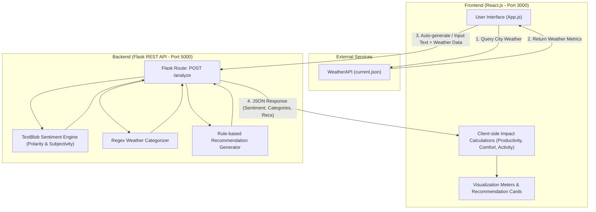
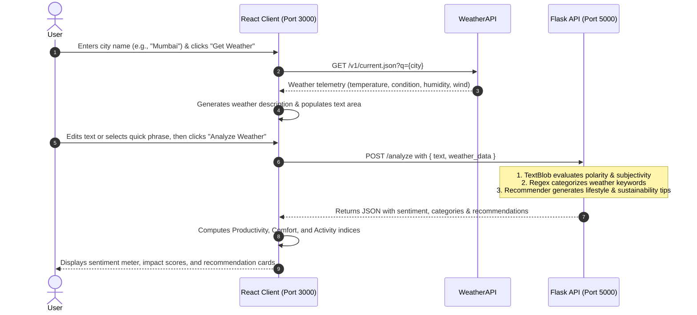

# 🌤️ Weather Sentiment Analysis & Recommendation System

---

<p align="center">
  
  
  
  
  
  <br/>
  
  
  
</p>

<p align="center">
  <strong>An intelligent full-stack AI system combining real-time meteorological data with Natural Language Processing (NLP) sentiment analysis to assess environmental impact, daily wellness, productivity feasibility, and eco-friendly climate action.</strong>
</p>

---

## 📌 Table of Contents

---

- [Overview](#overview)
- [Key Features](#key-features)
- [System Architecture](#system-architecture)
- [Tech Stack](#tech-stack)
- [Project Structure](#project-structure)
- [Getting Started](#getting-started)
  - [Prerequisites](#prerequisites)
  - [Installation & Setup](#installation--setup)
- [Usage & How to Run](#usage--how-to-run)
  - [1. Backend Setup (Flask API)](#1-backend-setup-flask-api)
  - [2. Frontend Setup (React Application)](#2-frontend-setup-react-application)
- [Workflow & How It Works](#workflow--how-it-works)
- [API Reference](#api-reference)
- [Configuration](#configuration)
- [License](#license)
- [Author](#author)

---

## Overview

The **Weather Sentiment Analyzer** bridges environmental monitoring with natural language perception. Users can query current weather for any city or enter custom weather impressions. The platform processes this text alongside live atmospheric readings (temperature, humidity, wind velocity, sky conditions) to determine:

1. **Sentiment & Emotion**: Analyzes tone, polarity, and subjectivity of weather descriptions.
2. **Weather Dimensions**: Classifies texts into categories like temperature, precipitation, wind, and sky condition.
3. **Daily Impact Scores**: Computes scores for productivity, comfort level, and outdoor activity feasibility.
4. **Context-Aware Recommendations**: Offers lifestyle recommendations, wellness tips, and climate action guidance tailored to the prevailing weather.

---

## Key Features

- **Real-Time Weather Integration**: Queries live weather conditions, temperature, humidity, and wind speed via the WeatherAPI.
- **NLP Sentiment Analysis**: Employs TextBlob to quantify sentiment polarity (negative to positive) and subjectivity (objective vs. subjective perception).
- **Automated Weather Summarization**: Synthesizes live weather telemetry into human-readable descriptive text ready for immediate analysis.
- **Quick-Select Weather Presets**: Pre-populated phrases for rapid testing and demonstrations.
- **Rule-Based Weather Categorization**: Uses regular expressions to parse descriptions into meteorological categories (temperature, precipitation, wind, sky condition).
- **Holistic Impact Assessment**:
  - 🎯 **Productivity Index**: Evaluates optimal conditions for focus and work.
  - 🌡️ **Comfort Level**: Balances thermal sensation and relative humidity.
  - 🏃 **Activity Feasibility**: Assesses safety and enjoyment for outdoor exercises.
- **Personalized Recommendations Engine**:
  - **Activities & Wellness**: Tailored suggestions for running, nature walks, home workouts, or mindfulness.
  - **Climate Action & Sustainability**: Immediate actions (energy conservation, green transit), resilience adaptation (rainwater collection, solar utilization), and climate awareness tracking.

---

## System Architecture

The application adopts a decoupled client-server architecture:



---

## Tech Stack

### Frontend
| Technology | Description |
| :--- | :--- |
| **React 18** | Component-driven UI development and state management (`useState`, `useEffect`) |
| **CSS3** | Modern responsive grid and flexbox layouts, visual meters, and animations |
| **HTML5 / JavaScript (ES6+)** | Modern asynchronous client logic with Fetch API |
| **WeatherAPI** | Third-party REST API for live meteorological data |

### Backend
| Technology | Description |
| :--- | :--- |
| **Python 3.8+** | Core runtime environment |
| **Flask** | Lightweight WSGI web application framework and RESTful routing |
| **Flask-CORS** | Cross-Origin Resource Sharing handling for React frontend communication |
| **TextBlob** | Natural language processing library for sentiment polarity and subjectivity |
| **Regular Expressions (`re`)** | Regex pattern matching for meteorological text categorization |

---

## Project Structure

```text
Weather_analysis-main/
├── backend/
│   ├── app.py                 # Flask server, NLP analysis & recommendation logic
│   └── requirements.txt       # Python dependencies (Flask, Flask-CORS, TextBlob)
├── public/
│   ├── index.html             # HTML entry point
│   └── manifest.json          # Web app manifest
├── src/
│   ├── App.css                # Application styles, meters, cards & animations
│   ├── App.js                 # Primary React component (UI, state, API calls)
│   ├── index.css              # Global styles
│   ├── index.js               # React DOM entry point
│   └── reportWebVitals.js     # Web performance measuring utility
├── package.json               # Node.js project manifest & scripts
├── package-lock.json          # Node dependency lockfile
└── README.md                  # Project documentation
```

---

## Getting Started

### Prerequisites

Ensure you have the following installed on your machine:
- **Node.js**: `v16.x` or higher ([Download Node.js](https://nodejs.org/))
- **npm**: `v8.x` or higher (bundled with Node.js)
- **Python**: `3.8` or higher ([Download Python](https://www.python.org/))
- **pip**: Python package manager

### Installation & Setup

1. **Clone the repository**:
   ```bash
   git clone https://github.com/KaustavSaha05/Weather-Analysis.git
   cd Weather-Analysis
   ```

2. **Install frontend dependencies**:
   ```bash
   npm install
   ```

3. **Install backend dependencies**:
   ```bash
   cd backend
   pip install -r requirements.txt
   cd ..
   ```

---

## Usage & How to Run

### 1. Backend Setup (Flask API)

1. Navigate to the `backend` directory:
   ```bash
   cd backend
   ```

2. *(Optional but recommended)* Create and activate a virtual environment:
   - **Windows**:
     ```bash
     python -m venv venv
     .\venv\Scripts\activate
     ```
   - **macOS / Linux**:
     ```bash
     python3 -m venv venv
     source venv/bin/activate
     ```

3. Install required Python packages:
   ```bash
   pip install -r requirements.txt
   ```

4. Download TextBlob corpora (if prompted on first run):
   ```bash
   python -m textblob.download_corpora
   ```

5. Start the Flask server:
   ```bash
   python app.py
   ```
   *The backend will run on `http://localhost:5000`.*

---

### 2. Frontend Setup (React Application)

1. In a new terminal window, navigate to the project root directory:
   ```bash
   cd Weather_analysis-main
   ```

2. Start the React development server:
   ```bash
   npm start
   ```

3. The application will launch in your browser at:
   ```
   http://localhost:3000
   ```

---

## Workflow & How It Works



---

## API Reference

### Analyze Weather & Sentiment

- **Endpoint**: `/analyze`
- **Method**: `POST`
- **Content-Type**: `application/json`

#### Request Body
```json
{
  "text": "The current weather in Mumbai is sunny with a temperature of 28°C.",
  "weather_data": {
    "temp_c": 28,
    "condition": "Sunny"
  }
}
```

#### Response Body
```json
{
  "sentiment": {
    "sentiment": "positive",
    "polarity": 0.5,
    "subjectivity": 0.4
  },
  "categories": {
    "temperature": true,
    "sky_condition": true
  },
  "recommendations": [
    {
      "icon": "🏃‍♂️",
      "title": "Perfect for Exercise",
      "description": "Ideal conditions for running, cycling, or outdoor workout."
    },
    {
      "icon": "🌱",
      "title": "Energy Conservation",
      "description": "Use natural ventilation when possible, minimize AC usage during peak hours."
    }
  ]
}
```

---

## Configuration

### WeatherAPI Key
The live weather search uses [WeatherAPI](https://www.weatherapi.com/).
- The API call is configured in [src/App.js](file:///d:/Weather_analysis-main/src/App.js#L143).
- To supply your own API key:
  1. Sign up for a free key at [WeatherAPI.com](https://www.weatherapi.com/).
  2. Replace the `key` query parameter in the `fetch` URL in `src/App.js`:
     ```javascript
     const response = await fetch(`https://api.weatherapi.com/v1/current.json?key=YOUR_API_KEY&q=${encodeURIComponent(location)}&aqi=no`);
     ```

---

## License

This project is licensed under the MIT License - feel free to adapt and build upon it!

---

## Author

**Developed by Kaustav Saha**

- 🐙 **GitHub**: [@KaustavSaha05](https://github.com/KaustavSaha05)
- ✉️ **Email**: [kaustav.saha04@gmail.com](mailto:kaustav.saha04@gmail.com)
